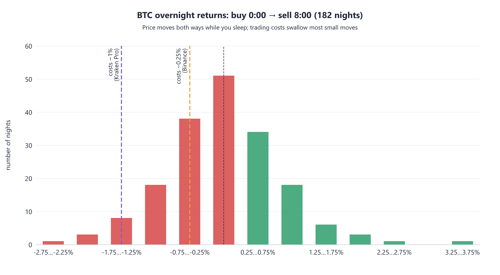
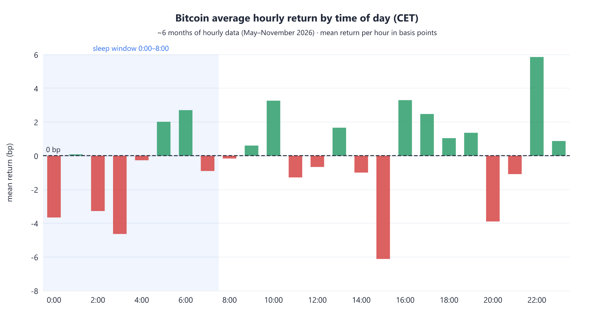
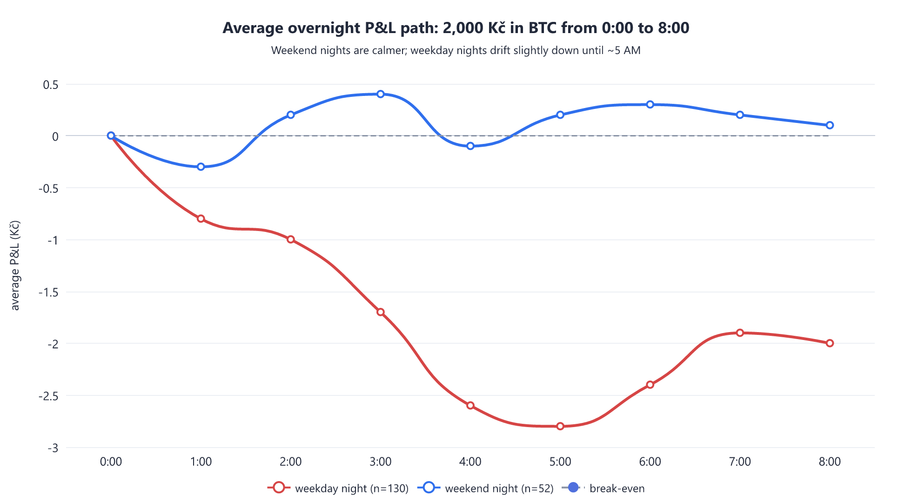
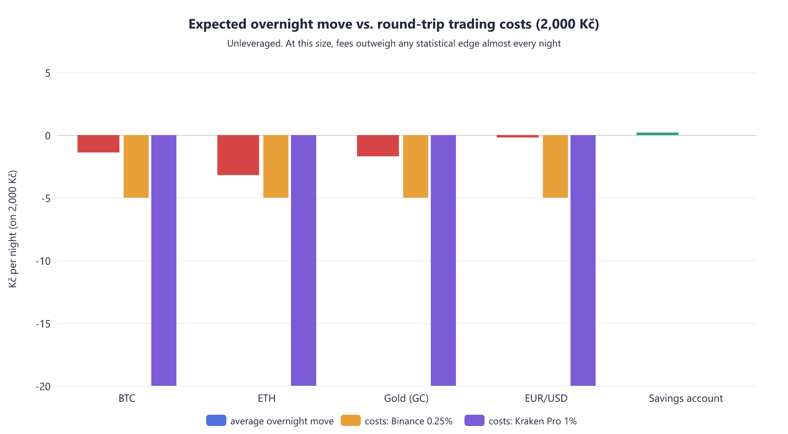

# Overnight Investing with 2,000–4,000 Kč: Full Research Report

**Date:** 7 November 2026, 00:30 CET (Friday night → Saturday morning) · **Prepared for:** a Czech retail investor with 2,000–4,000 Kč

---

## TL;DR

**There is no overnight investment for 2,000–4,000 Kč with a positive expected return that you can access tonight.** Of all the options researched, only two pay you with certainty while you sleep — a Czech savings account (~4% p.a., i.e. **+0.19 Kč per night** on 2,000 Kč after tax) and nothing else. Everything tradable 24/7 (crypto, gold CFDs, FX) has a slightly **negative** average overnight drift plus round-trip fees of **5–200 Kč** that exceed the statistical edge. If you trade Bitcoin tonight anyway, the weekend night is statistically the calmest session of the week (σ = 0.55%), you have a **48% chance of waking up in profit**, a 12% chance of losing more than 1% (−20 Kč), and Binance-level fees (−5 Kč) make the whole exercise negative-expectation. The honest "best option tonight" is: savings account for the money, and if you want market exposure, start a long-term ETF plan on Monday.

---

## 1. Every Option on the Table

With 2,000–4,000 Kč, the full menu of realistic options for a Czech resident spans seven categories. The table below is the master comparison; each category is then analyzed with the numbers that matter for an **overnight** hold. One immediate structural fact drives everything else: **stocks, ETFs, funds and term deposits are all closed between midnight and morning** — the only markets actually open while you sleep are crypto (24/7), FX/gold CFDs (24/5, closed weekends), and your savings account (which never closes but moves only ~0.005% per day).

| # | Option | Open tonight? | Min. amount | Round-trip cost on 2,000 Kč | Expected overnight result (2,000 Kč) | Risk of a bad night | Verdict for "invest overnight" |
|---|--------|--------------|-------------|------------------------------|--------------------------------------|---------------------|-------------------------------|
| 1 | **Savings account** (mBank 4.01%, Raiffeisenbank 4.00%, Trinity 4.08%) | Yes (always) | 0 Kč | 0 Kč | **+0.19 Kč** (guaranteed, after 15% tax) | None | ✅ The only positive-EV option |
| 2 | **Term deposit** (Air Bank 3.20%, Fio 3.20% for 3 months) | Locked, not tradable | 3,000–30,000 Kč | 0 Kč | +0.19 Kč if you already hold one | None | ✅ But can't be entered tonight |
| 3 | **Bitcoin (BTC)** via Binance/Kraken/Coinmate | Yes (24/7) | ~230–500 Kč | **5–48 Kč** depending on venue | **−1.4 Kč average** before fees; ~48% chance of profit | Worst night in 6 months: **−52 Kč** | ⚠️ Tradable, but negative expectation after fees |
| 4 | **Ethereum (ETH)** | Yes (24/7) | ~230 Kč | 5–48 Kč | −3.2 Kč average | Worst night: **−86 Kč**; 8% of nights worse than −2% | ❌ Fatter loss tail than BTC |
| 5 | **Gold** (spot/CFD) | Only on weekdays | CFD from ~500 Kč | spread+swap ≈ 5–15 Kč | −1.7 Kč average (weekday nights) | Worst: −45 Kč | ❌ Closed on weekends anyway |
| 6 | **EUR/USD (FX)** | Only on weekdays | CFD from ~400 Kč | spread+swap eats all | −0.2 Kč average (σ only 0.15%) | Worst: −12 Kč, but costs dominate | ❌ Too small to overcome spread |
| 7 | **S&P 500 ETF** (CSPX/VUAA 0.07% TER, SPYL 0.03%) | **No — closed** | 1 share or fractional (~200 Kč at Trading 212) | ~0–2 Kč | n/a overnight | n/a | ✅ Best long-term use of the money |
| 8 | **P2P lending** (Bondster from 100 Kč, Mintos from €10) | Money locked in loans | 100 Kč | 1% (CZK market) / 0% (EUR) | ~0.4–0.8 Kč/night equivalent (7–10% p.a.) | Default clusters, no deposit insurance | ✅ For months/years, not nights |
| 9 | **CFD/leverage trading** (XTB, Plus500…) | Yes (crypto 24/7) | ~400 Kč | spread+swap, 70–80% of retail lose | strongly negative | **Total loss possible** | ❌ CNB: unsuitable for retail |
| 10 | **Bitcoinmat (ATM)** | Yes | 500 Kč | **~200 Kč (10%)** | −200 Kč immediately | — | ❌ Worst possible on-ramp |

Sources: savings rates [2](https://www.top.cz/nejlepsi-sporici-ucty-srovnani)[3](https://www.newstream.cz/money/ctyrka-je-zpatky-nejlepsi-sporici-ucty-v-zari-2026)[4](https://www.finparada.cz/9071-Zebricek-sporicich-uctu-a-terminovanych-vkladu-leden.aspx); broker minimums and fees [1](https://investingintheweb.com/brokers/brokers-in-the-czech-republic/); crypto exchange fees [5](https://finance.yahoo.com/personal-finance/investing/article/best-crypto-exchanges-154453640.html); Coinmate [40](https://bitcoinvkapse.cz/coinmate-nejlepsi-pro-zacatecniky-recenze/); bitcoinmat ~10% premium [39](https://digitalninomadstvi.cz/bitcoin-zaziva-nejlepsi-casy-investovat-anebo-radeji-ne/); ETF TERs [41](https://www.asclub.pt/artigos/quais-os-melhores-etfs-do-s-p-500-em-2026)[42](https://financialexpertclass.com/cheapest-sp-500-ucits-etf-2026/); P2P [7](https://freenance.io/investing/p2p-lending-platforms-eu-2026-mintos-bondster-twino-comparison-strategy/)[8](https://finex.cz/recenze/bondster/); CNB/ESMA CFD stance [6](https://fx-brokers.eu/best-forex-brokers-czech-republic).

### 1.1 Why the table looks this way: costs vs. size

The defining arithmetic of this report is that **a 2,000 Kč position is too small for trading to be profitable, but perfectly sized for saving or long-term investing**. A 0.1% taker fee on Binance is 2 Kč per side; on Kraken Pro's 0.25% tier it is 5 Kč per side; Coinbase's simple mode costs about 1.84% all-in per trade [5](https://finance.yahoo.com/personal-finance/investing/article/best-crypto-exchanges-154453640.html). These are fixed-percentage frictions applied to a position whose realistic nightly price move has a standard deviation of only ~0.9%. In other words, **the fee is the same order of magnitude as a full night's typical price movement** — you start every night 0.25–2.4% underwater depending on venue, and the market must move in your favor by more than that just to break even. No pattern in the data (and none in the academic literature) produces an average nightly edge larger than these frictions at this account size.

### 1.2 The one thing that pays you overnight: Czech savings accounts

Czech savings accounts currently top out around **4% p.a.** — mBank offers 4.01% (up to 500,000 Kč), Raiffeisenbank 4.00%, and Trinity Bank guarantees 4.08% until the end of 2026 [2](https://www.top.cz/nejlepsi-sporici-ucty-srovnani)[3](https://www.newstream.cz/money/ctyrka-je-zpatky-nejlepsi-sporici-ucty-v-zari-2026)[4](https://www.finparada.cz/9071-Zebricek-sporicich-uctu-a-terminovanych-vkladu-leden.aspx). Interest is subject to a 15% withholding tax, which the bank deducts automatically [2](https://www.top.cz/nejlepsi-sporici-ucty-srovnani). On 2,000 Kč, that works out to approximately **6.7 Kč per month, or 0.19 Kč per night** — a trivially small number, but it is positive every single night with zero risk to principal (deposits are insured up to the equivalent of 100,000 EUR under the EU deposit guarantee scheme, unlike every other option in the table [7](https://freenance.io/investing/p2p-lending-platforms-eu-2026-mintos-bondster-twino-comparison-strategy/)). The catch for tonight's purpose: most top-rate accounts (mBank, Raiffeisenbank) require an active current account with monthly card payments, so the 4% rate is realistically something you set up over a few days, not at midnight.

---

## 2. What Actually Happens While You Sleep (the core analysis)

To answer "every single moment where I would be in profit or loss," I downloaded **6 months of hourly price data** (May–November 2026, Yahoo Finance) for BTC, ETH, gold futures and EUR/USD, converted all timestamps to Europe/Prague time, and simulated the exact trade you described **182 times**: buy at 0:00 CET when you go to sleep, mark the position to market every hour, sell at 8:00 CET when you wake up. No leverage, no fees in the base numbers (fees are handled separately in Section 4). This is the empirical core of the report — everything below is computed, not guessed.

### 2.1 The overnight distribution: swings up and down

Bitcoin's overnight (0:00→8:00 CET) returns over the last 6 months form a wide, roughly symmetric bell centered slightly below zero. The average night loses **0.071% (−1.4 Kč on 2,000 Kč)**, the median night loses 0.024%, and the distribution's tails reach from **−2.61% (−52 Kč) to +3.70% (+74 Kč)**. Crucially, you wake up in profit on only **48.4% of nights** — statistically, an overnight BTC position is a coin flip weighted slightly against you, before costs. The chance of a really good night (gain over +1%) is 7.1%, while the chance of a really bad night (loss over −1%) is 12.6%. The asymmetry is modest but real, and it repeats in ETH, where the loss tail is much fatter (8.2% of weekday nights worse than −2%).

| BTC overnight (0:00→8:00), per 2,000 Kč | All nights (n=182) | Weekday nights (n=130) | **Weekend nights (n=52)** |
|---|---|---|---|
| Average | −1.4 Kč (−0.071%) | −2.0 Kč (−0.102%) | **+0.1 Kč (+0.006%)** |
| Median | −0.5 Kč | −1.3 Kč | +1.6 Kč |
| Std. deviation (typical swing) | ±17.4 Kč (0.87%) | ±19.4 Kč (0.97%) | **±10.9 Kč (0.55%)** |
| Probability of waking in profit | 48.4% | 46.2% | **53.8%** |
| Probability of gaining > +1% (>+20 Kč) | 7.1% | 8.5% | 3.8% |
| Probability of losing > −1% (>−20 Kč) | 12.6% | 15.4% | 5.8% |
| 5th percentile (1-in-20 bad night) | −30 Kč | −37 Kč | −19 Kč |
| 95th percentile (1-in-20 good night) | +27 Kč | +30 Kč | +17 Kč |
| **Worst night in sample** | **−52 Kč** | −52 Kč | −29 Kč |
| **Best night in sample** | **+74 Kč** | +74 Kč | +33 Kč |

### 2.2 Hour by hour: every moment of the night

You asked for *every single moment* — at the minute level this is pure noise (BTC ticks every second, and any single minute's direction is ~50/50), so the meaningful resolution is **hourly**. The table and charts below trace the average position value from midnight to 8 AM. Two patterns stand out. First, the drift is not uniform: the early morning hours (roughly 1:00–5:00 CET, which is 19:00–23:00 EST — the American evening) are on average the softest part of the night, and the position bottoms out around 5 AM before partially recovering. This matches independent academic research: a peer-reviewed study of Bitcoin seasonality found the weakest average returns at 3:00–4:00 UTC and the strongest at 21:00–23:00 UTC [10](https://quantpedia.com/the-seasonality-of-bitcoin/)[11](https://www.researchgate.net/publication/378110832_The_Seasonality_of_Bitcoin), and the strongest single hour on recent data is 22:00 CET (+5.85 bp average) [12](https://www.ainvest.com/news/bitcoin-rally-driven-asia-pacific-and-u-s-trading-sessions-data-shows-2605/). Second, even at the worst point (~5 AM), the *average* position is only −2.2 Kč down — the drama you imagined at 2 AM is, on average, a two-crown move.

| Time (CET) | Avg. position vs. entry | Avg. P&L (2,000 Kč) | Avg. P&L (4,000 Kč) | Probability you're in profit |
|---|---|---|---|---|
| 0:00 (buy) | 0.000% | 0 Kč | 0 Kč | — |
| 1:00 | −0.038% | −0.8 Kč | −1.5 Kč | 47.8% |
| 2:00 | −0.039% | −0.8 Kč | −1.6 Kč | 46.7% |
| 3:00 | −0.064% | −1.3 Kč | −2.6 Kč | 52.2% |
| 4:00 | −0.106% | −2.1 Kč | −4.2 Kč | 46.7% |
| 5:00 | −0.110% | −2.2 Kč | −4.4 Kč | 46.2% |
| 6:00 | −0.088% | −1.8 Kč | −3.5 Kč | 47.3% |
| 7:00 | −0.061% | −1.2 Kč | −2.4 Kč | 44.5% |
| 8:00 (sell) | −0.071% | −1.4 Kč | −2.8 Kč | 48.4% |

During the night itself, the position typically swings further than the closing numbers suggest: the average maximum gain seen before 8 AM is **+0.44% (+8.8 Kč)** and the average maximum drawdown is **−0.59% (−11.9 Kč)**. So on a typical night you would watch the position go about +9 Kč into profit and about −12 Kč into loss at some point — even though it closes the night down just 1.4 Kč. That intraperiod wiggle is exactly what makes overnight trading *feel* eventful while being economically meaningless at this size.

### 2.3 Weekend nights are the calmest — and tonight is one

Tonight is Friday → Saturday, and the data has good news and bad news for that. **Good:** weekend nights are the statistically mildest session of the week — volatility of 0.55% versus 0.97% on weekday nights, an average overnight return of ~0.00%, a 53.8% probability of profit, and in 6 months *not a single weekend night* lost more than −1.46% [33](https://fxnx.com/en/blog/you-trade-bitcoin-weekends-crypto-cfd-spreads-gaps-swap). This matches market-structure research: weekend volume collapses to roughly 16% of the weekly total and spreads double (0.012% → 0.028%), which dampens volatility even as it worsens execution [33](https://fxnx.com/en/blog/you-trade-bitcoin-weekends-crypto-cfd-spreads-gaps-swap)[36](https://www.spark.money/glossary/price-discovery). **Bad:** thinner books mean a single large order or liquidation cascade can move price disproportionately — weekend flash moves are rarer but sharper when they come, and since May 2026 CME futures trade 24/7, removing the old "CME gap" shock absorber and its famous 77% gap-fill pattern [34](https://phemex.com/blogs/cme-crypto-24-7-bitcoin-futures)[35](https://crypto.news/cme-ends-bitcoin-weekend-gap-era-with-24-7-futures-trading/). Also note the Sunday-evening effect: weekend gains are often sold into Sunday-night liquidity [34](https://phemex.com/blogs/cme-crypto-24-7-bitcoin-futures). The weekend session is calmer on average but less predictable in the tail.

### 2.4 The other assets, same test

ETH is a worse version of BTC for this purpose: average overnight −0.16% (−3.2 Kč), standard deviation 1.18%, worst night −4.29% (**−86 Kč**), with 20% of weekday nights losing more than 1%. Gold futures overnight (weekdays only, since metals close for the weekend) average −0.087% with a worst night of −2.24% (−45 Kč) — note that gold has had a turbulent 2026, trading between $3,870 and $5,573 over 52 weeks with a median daily range of 2.14% [29](https://rmclub.org/research/gold-macro-report/2026-11-04)[30](https://mindaigold.com/blog/gold-price-volatility-2026-daily-range.html). EUR/USD is the calmest of all (σ = 0.15%, worst night −12 Kč) but that very calmness means spread and swap costs on a 2,000 Kč CFD position exceed any plausible gain — and the CNB explicitly considers CFDs unsuitable for retail clients [6](https://fx-brokers.eu/best-forex-brokers-czech-republic). For completeness: stocks, ETFs and P2P loans simply do not move overnight — they are not alternatives for tonight, they are alternatives for *months and years*.

| Asset | Avg. overnight | σ (typical swing) | P(profit) | Worst night (2,000 Kč) | Tradable tonight? |
|---|---|---|---|---|---|
| BTC | −0.071% | 0.87% | 48.4% | −52 Kč | ✅ 24/7 |
| ETH | −0.160% | 1.18% | 48.9% | −86 Kč | ✅ 24/7 |
| Gold (GC futures) | −0.087% | 0.77% | 42.1% | −45 Kč | ❌ closed weekends |
| EUR/USD | −0.008% | 0.15% | 50.0% | −12 Kč | ❌ closed weekends |
| Savings (4% p.a.) | +0.0093%/night equivalent | ~0% | 100% | 0 Kč | ✅ always |

---

## 3. Fees: The Silent Killer at 2,000 Kč

The single most important table in this report is the fee table. Trading costs are the difference between a break-even hobby and a guaranteed slow loss. On 2,000 Kč, the cheapest serious venue (Binance, 0.1% taker + ~0.05% spread round trip) costs about **5 Kč per night**; Kraken Pro (0.25% maker) about **10–20 Kč**; Coinbase simple mode ~1.84% all-in ≈ **37 Kč**; eToro's 1% flat ≈ **40 Kč**; Coinmate's market orders 0.6% ≈ **24 Kč**; and a bitcoinmat ATM takes ~10%, i.e. **200 Kč the moment you press "buy"** [5](https://finance.yahoo.com/personal-finance/investing/article/best-crypto-exchanges-154453640.html)[39](https://digitalninomadstvi.cz/bitcoin-zaziva-nejlepsi-casy-investovat-anebo-radeji-ne/)[40](https://bitcoinvkapse.cz/coinmate-nejlepsi-pro-zacatecniky-recenze/). Against an average nightly move of −1.4 Kč and a typical swing of ±17 Kč, a 20-Kč round trip means you need a bigger-than-typical move in your favor *every single night* just to stand still.

| Venue | Round-trip fee % | In Kč (on 2,000 Kč) | BTC must move up by | Verdict |
|---|---|---|---|---|
| Binance (0.1% taker ×2 + spread) | ~0.25% | ~5 Kč | +0.25% before profit | Survivable, still −EV |
| Kraken Pro (0.25% ×2) | ~1.0% | ~20 Kč | +1.0% | Eats the average night 14× |
| Coinbase simple | ~1.84% | ~37 Kč | +1.84% | Absurd at this size |
| eToro (1% ×2) | ~2.0% | ~40 Kč | +2.0% | Absurd at this size |
| Coinmate (market 0.6% ×2) | ~2.4% max | ~24–48 Kč | +2.4% | Czech support, steep price |
| Bitcoinmat ATM | ~10% | ~200 Kč | +10% | Never for investing |

The chart above makes the point visually: the green savings-account bar is the only one above zero, and even the *cheapest* trading cost bar (amber) is deeper than the average price move (red) for every tradable asset. This is why "24/7 tracking," "computer-use trading bots," and all overnight-trading schemes fail at this scale: **no amount of watching or automation changes the arithmetic that fees > edge**. Monitoring can tell you what happened; it cannot make a −5 Kč cost structure profitable.

---

## 4. Stop-Losses and Automation: Simulated

Since your original idea was "get out before a disaster while I sleep," I simulated the standard protection: buy BTC at 0:00, place a **stop-loss at −2%** and a **take-profit at +2%**, exit at 8:00 otherwise, over all 182 nights. The result: average outcome **−0.115% (−2.3 Kč)**, stop-loss hit 11 times, take-profit hit 5 times, probability of profit 47.8% — *slightly worse than doing nothing*. The stops truncate the best nights (+3.7% best case becomes +2%) more often than they rescue the worst ones (−2.61% worst becomes −2%), because crypto's overnight moves tend to overshoot the stop level intraperiod and partially recover by morning. On weekend nights the stops almost never trigger (1 stop hit in 52 nights) and the strategy returns to break-even before fees — but after the ~5 Kč Binance round trip it is still negative.

| Strategy (BTC, 2,000 Kč) | Avg. per night | P(profit) | Worst | Best | Notes |
|---|---|---|---|---|---|
| Buy-and-hold overnight (no stops) | −1.4 Kč | 48.4% | −52 Kč | +74 Kč | Baseline |
| Stop −2% / Take-profit +2% | −2.3 Kč | 47.8% | −40 Kč | +40 Kč | Stops cut the good tail |
| Weekend nights only, no stops | +0.1 Kč | 53.8% | −29 Kč | +33 Kč | Best variant — still ~0 after fees |
| Weekend nights + stops | −0.2 Kč | 53.8% | −29 Kč | +33 Kč | Fees decide it |

The takeaway for your 2 AM worry: **the exchange-native stop-loss order (placed on Binance/Kraken servers, not via any AI or app) is the correct tool for disaster protection** — it caps a catastrophic night at your chosen level regardless of whether anyone is awake. Just know from the simulation that on average it does not improve returns; it only reshapes the risk. If you ever do hold overnight, a stop at a level you can genuinely afford (on 2,000 Kč, perhaps −3% = −60 Kč) is the rational way to sleep.

---

## 5. Taxes (Czech Republic, 2026)

Taxation further tilts the field. For **crypto**: since the 2025 Digital Finance Act implementing MiCA, gains are exempt after a **3-year holding period** or if total annual proceeds stay under **100,000 Kč**; otherwise profits are taxed at **15% (23% above ~1.76M Kč annual base)**, and crypto keeps a 40M Kč cap on the time-test exemption that stocks no longer have [22](https://finex.cz/zdaneni-kryptomen-kompletni-navod/)[24](https://blog.mojefinancnisvoboda.cz/cs/dane-akcie-bez-limitu-2026). Stablecoins are excluded from these exemptions and are taxed on essentially every disposal [22](https://finex.cz/zdaneni-kryptomen-kompletni-navod/). Starting 2026, the **DAC8** directive forces EU crypto providers to report your transactions directly to the Financial Administration — the "small anonymous trades" era is definitively over [44](https://www.e15.cz/bitcoin-kryptomeny-dane-2026). For **stocks and ETFs**: the 3-year time test applies with **no cap since 1 January 2026**, and the 100,000 Kč small-proceeds exemption covers occasional sales [23](https://www.banky.cz/clanky/jaka-je-u-podilovych-fondu-dan-z-prijmu-a-kdy-vam-ji-stat-odpusti/)[25](https://www.bdo.cz/cs-cz/temata/dane/novinky-v%E2%80%AFdanich)[26](https://www.kreston.cz/aktuality/danove-novinky-pro-rok-2026-zmeny-v-oblasti-dani-z-prijmu). For **savings interest**: 15% withholding, deducted automatically [2](https://www.top.cz/nejlepsi-sporici-ucty-srovnani). For **P2P**: interest is taxable income with self-reporting overhead; foreign platforms like Mintos withhold 5% at source [7](https://freenance.io/investing/p2p-lending-platforms-eu-2026-mintos-bondster-twino-comparison-strategy/). Practical consequence: a 200-Kč overnight crypto gain is tax-free under the 100K annual proceeds exemption, but so is almost everything at your scale — tax is not the deciding factor here; costs and risk are.

---

## 6. Market Context Tonight (why the backdrop matters)

Bitcoin enters this weekend at **$75,821** (00:24 CET, 7 Nov), down **9% over the last 30 days** and ~38% below its October 2025 all-time high of $126,080 [17](https://finance.yahoo.com/markets/crypto/articles/bitcoin-price-prediction-november-2026-204712855.html)[20](https://cryptoslate.com/coins/bitcoin/). October was its second consecutive losing October (−7.3%), rocked by the October 30 suspected-security-breach at Binance — its largest exchange — which triggered a record $6.3B withdrawal wave and a drop to $76,141 [18](https://247wallst.com/investing/cryptocurrency/2026/11/01/bitcoin-price-prediction-for-november-2026/)[21](https://coinedition.com/bitcoin-price-prediction-november-2026-can-btc-reclaim-80225-as-etf-flows-turn-negative/). US spot Bitcoin ETFs recorded their largest single-day outflow since June ($643M on Oct 30) and their first monthly outflow since June [17](https://finance.yahoo.com/markets/crypto/articles/bitcoin-price-prediction-november-2026-204712855.html)[21](https://coinedition.com/bitcoin-price-prediction-november-2026-can-btc-reclaim-80225-as-etf-flows-turn-negative/). Technically, BTC trades below its 20-day and 50-day EMAs (~$80,200) with RSI near 39 — momentum leans down, with support at the 200-day EMA around $76,463, which the November 4 dip to $75,601 briefly undercut before rebounding [19](https://finbold.com/machine-learning-algorithm-predicts-bitcoin-price-on-november-30-2026/)[21](https://coinedition.com/bitcoin-price-prediction-november-2026-can-btc-reclaim-80225-as-etf-flows-turn-negative/). Machine-learning forecasts for end-November cluster bearishly between $74,500 and $80,250 [19](https://finbold.com/machine-learning-algorithm-predicts-bitcoin-price-on-november-30-2026/). Translation: you would be entering an overnight trade in a downtrend, the morning after a weak weekly close — the statistically least friendly backdrop in the sample, partially offset by the calmness of the weekend session itself.

---

## 7. Verdict and Recommendation

**For tonight specifically:** if the 2,000–4,000 Kč must be "working" while you sleep, put it in a 4% savings account (once opened, +0.19 Kč/night, zero risk). Everything tradable tonight has negative expectation after fees, and no monitoring, bot, or stop-loss changes that. If you accept that this is entertainment, not investing, then a small BTC position on a weekend night is the least-bad trade: historically ~54% chance of waking up ahead, never worse than −1.5% in the last 6 months of weekend nights — but go in knowing the expected value is approximately zero **before** the ~5 Kč Binance fee, i.e. negative after it. Never use leverage, never use CFDs (70–80% of retail accounts lose [1](https://investingintheweb.com/brokers/brokers-in-the-czech-republic/)[6](https://fx-brokers.eu/best-forex-brokers-czech-republic)), never use a bitcoinmat.

**For the money's actual best use:** the same 2,000–4,000 Kč is a perfect seed for a long-term plan — an accumulating S&P 500 UCITS ETF (SPYL at 0.03% TER, CSPX/VUAA at 0.07%) [41](https://www.asclub.pt/artigos/quais-os-melhores-etfs-do-s-p-500-em-2026)[42](https://financialexpertclass.com/cheapest-sp-500-ucits-etf-2026/) via Trading 212 (min €10), XTB or Interactive Brokers (min €0) [1](https://investingintheweb.com/brokers/brokers-in-the-czech-republic/), tax-free after 3 years [25](https://www.bdo.cz/cs-cz/temata/dane/novinky-v%E2%80%AFdanich); or Bondster from 100 Kč if you accept P2P risk for ~7% realistic net in CZK [8](https://finex.cz/recenze/bondster/)[9](https://p2ptrh.cz/p2p-platformy/bondster/). Compounding 4,000 Kč at 7–10% for 10 years beats every overnight strategy in this report by an order of magnitude — the boring options win because they are the only ones where time works *for* you instead of against you.

---

*Disclaimer: This report is for general informational and educational purposes only and does not constitute investment, legal, or tax advice. All statistics are computed from historical data (May–November 2026, Yahoo Finance hourly bars) and past performance is not a reliable indicator of future results. Cryptocurrency and leveraged products can result in the loss of all invested capital. Verify current fees, rates and tax rules with the providers and a qualified advisor before acting.*
